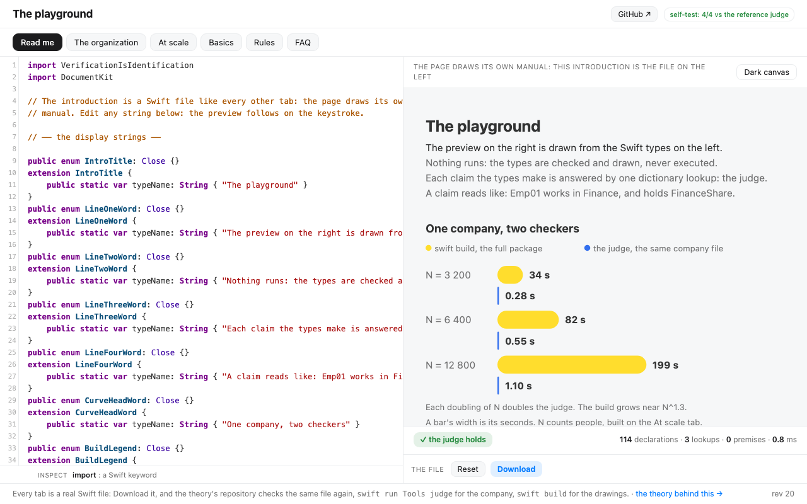

# The playground

This is zero-runtime programming, applied to everything on one page: layout, a
company of 12,800 people, the physics of light, a hydrogen atom. Every domain is
Swift types and nothing executes: the company's plain court reads a file into a
dictionary and answers every claim by a single lookup, and the theory's where
and count courts read a world's certificates and answer each by reducing the
definitions it names. The plain check is linear in the file where compilation
grows near N^1.3: the company that `swift build` proves in 199 seconds is
re-checked here in 0.2, on every keystroke, and a broken claim in any domain is
a line number. All of it is checkable right here: a static page, ten files, no
server, no build.

Swift types on the left, the page drawn from them on the right: every tab is
one Swift file in a stated subset of the language, `swift build` compiles it,
the judge names a broken claim by its line as you type, and a renderer draws
every declared canvas from the same dictionary. The one vendored library is CodeMirror 5 (MIT), the editor
pane. `judge.js` is a line-for-line port of the company's plain court from the
theory's showcase package, `renderer.js` is a mirror of its span engine,
`press.js` of its rule applier, and `lint.js` of rule 0 of its linter.
`guards.js` states the four objections the fast reader leaves to the compiler,
and `check.js` runs them over every world. The where court and the count court
are not ported: `court/` carries the corpus court itself, built for wasm32 at
the theory revision `court/court-wasm.from` names and taken from the gate
repository at the revision `court/module.from` names. A judged world is read
beside two lent definitions files, the lattice's `Primitive.swift` and the
kit's `Spectrum.swift`, laid from the pinned revisions by `court/lay.sh` and
recorded with their bytes in `court/definitions.from`. A port of a court that
reduces definitions would be a second record of the canon, and two readings of
one judge agree only under a premise outside both.

The page is printed from its own declarations as well. `corpus/Manifest.swift`
states the worlds it ships and the tabs it shows, and `corpus/Palette.swift`
states every colour as a mix of the screen's three lights, with the contrast
each pair of them must clear written as a certificate. That contrast law is
stated and not judged, and the page says so: the where court stops at its
normalization budget over the palette's arithmetic, and the count court of this
version reads no product and no side this large (one constant of the bound,
7 × 8192, is above its budget alone); the law waits for a count court that
counts a named definition once. `build.mjs` reads both files with the same
reader the page runs and prints `index.html` from what they state, so a world
added and forgotten or a name that drifts between two files is a failed check
rather than something a reader notices later.

Live: <https://danielswift1992.github.io/typed-playground/>, or open
`index.html` from a checkout. The page is ten files in one folder:
`index.html`, `codemirror.js`, `codemirror.css`, `judge.js`, `lint.js`,
`press.js`, `guards.js`, `renderer.js`, `court/vi_court.js`, and
`court/vi_court_bytes.js`.

## What to press

The first tab, Read me, is the page's own manual, drawn from a Swift file like
every other tab: the thesis, the measured curve of `swift build` against the
judge, and what to try. The organization tab is a company as types. Hire one
more adds a typed employee, and the page redraws the counted cards. Plant a lie flips one
declaration deep in the file, and the judge refuses it by line and by name. The At
scale tab is the same company at 12,800 people, about 136,000 lines, and the
judge re-reads all of it in about 0.2 seconds on each edit, where `swift build`
on the same company measures 199.

On the Buttons tab every key on the canvas is a rule declared in the file as
three aliases: `Slot`, `From`, and `Into`. A press rewrites exactly one
`typealias` line, a press with no match changes nothing, and a key whose rules
match twice is refused by name. On the typewriter tab the page routes your keyboard through the same press:
a keystroke appends one character to a quoted literal in the file.

The Light tab is a lamp written as code. A picker mixes the lamp's spectral
lines one click per level, the gas itself is one rewritable line with hydrogen,
neon, and sodium behind it, and the page computes every colour on the canvas
from the file and prints it as `color(xyz-d65 …)` for the screen to map. The
line weights are from the CIE 1931 table, and the where court holds
metamerism, crossed polarizers, and two-slit fringes as eleven type
equalities. The Light and Atom tabs are two files each: the declarations and
certificates the court reads, in the editor, and the page bodies the compiler
reads, drawn behind it.

The atom tab is the reason behind the lamp: one electron on a ladder of floors,
written as one rewritable line. Every key is a written jump, each allowed jump
is a flash of its own line in a window under the ladder, and the selection rule is a
judged `where` requirement on every certificate. The energy is recorded as one
number per floor, 144 over the floor squared. The four energy stitches are
equalities of counts, not of types: the where court refuses them as type
equalities, because equal counts do not identify types, and the count court
holds the same numbers as ten readings of one question, 9 + 7 reading as the
recorded 16 and 9 + (7 + 20) as the same 36 the direct road reaches. The jump from 2s to the ground
floor cannot change the lobes by one pair, so it has no key and no certificate:
the electron there is stuck, the way the real one is stuck for a
tenth of a second.

Under the preview a Code · Table switch reads the same file as rows, one row per
declaration and one column per axis. Nothing is stored, so the table cannot
differ from the file, and on a click the editor opens the name's line. Beside the canvas,
Dark canvas repaints the drawings under the dark palette. Type `func` or `var`
on any line: rule 0 of the linter refuses it in orange, because a file here
declares types and nothing that runs. The one
admitted value form is `static var typeName`, a text constant read off the type.

Every tab is a real Swift file. Download it, and the pinned packages check the
same file again: `swift run ShowcaseTools judge` in the showcase for the
company, `swift run Tools judge where` in the theory for the certificates,
`swift build` for the drawings.

## The checks

The badge in the corner re-runs four recorded verdicts against the ported plain
court on every load. In CI, `node check.js` replays twenty-nine checks: the four
verdicts, every world of the page read, lawed, drawn clean, and read by the
page's own guards, the renderer's byte golden against
`swift run DynamicsDemo draw`, the court's refusals on a broken halving, an
even gap, a forbidden jump, a wrong road and a forbidden absorption, the lamp's
eleven equalities, the count question on the atom's ladder with a lie in one
drop naming both numbers, the palette's bound stated and not judged, the court
module and the lent definitions as the bytes their records name, four planted
lies that each guard must name, the kit's forty-line golden plate, reprinted byte
for byte by the showcase at its pin, which the port must read value for value, the palette read against every custom property
the stylesheet asks for, and the numbers this file states, counted here rather
than remembered. `node check-kit.js` checks all seventy-two ported
kit names against the kit's sources at a pinned commit, fifty-seven of them
sealed by goldens. `./check-theory.sh` turns the direction around: `swift build`
compiles every world against the lattice and the kit at the revisions
`Package.swift` pins, and the court module answers the four questions the
corpus states; with a theory checkout named, the theory's own `Tools judge`
answers them too, and the two answers are compared line for line.

## The theory

A verdict is an identification: the dictionary is built once, and every claim is
one lookup in it, so a lie planted 136,000 lines deep in the generated company
is refused in milliseconds. The papers, the Swift judge, and the full Swift
codebase live at
<https://danielswift1992.github.io/verification-is-identification/>.
